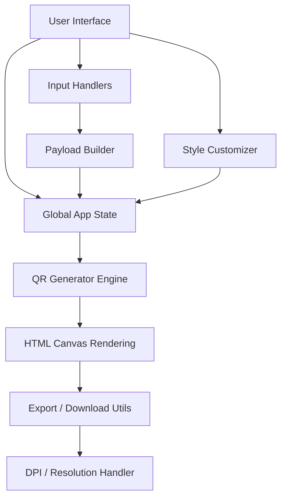

# Client-Side Architecture

The QR Code Gen is built as a **100% client-side application**. It requires no server-side processing for QR generation, image manipulation, or exporting.

This document explains the high-level architecture, module structure, and data flow of the application.

---

## 🏗️ High-Level Design

The application follows a modular, component-based structure using Vanilla JavaScript and Vite as the build tool.



---

## 📁 Module Breakdown

The logic is split into four main domains under `src/`:

### 1. `components/` (UI & User Interaction)
Handles everything the user interacts with directly:
- **`input-forms.js`**: Renders dynamic forms based on the selected QR type (e.g., showing SSID/Password fields for WiFi, or To/Subject/Body for Email).
- **`customizer.js`**: Manages the design controls (colors, shapes, dot styles, gradients, logo settings).
- **`error-handler.js`**: Centralized validation and error messaging (e.g., warning if data exceeds QR capacity, low-contrast alerts).

### 2. `qr-engine/` (Core Data & Rendering)
The heart of the application, managing data formulation and the actual drawing process:
- **`payload-builder.js`**: Takes raw user input from the forms and formats it into standardized QR payloads (e.g., converting a phone number into a `tel:` URI, or building a `WIFI:` string).
- **`generator.js`**: Wraps the underlying QR code library (`qr-code-styling`), handling debounced live-rendering to the DOM.
- **`logo-handler.js`**: Uses the `FileReader` API to parse user-uploaded images and the `Canvas` API to resize, crop, and embed logos into the center of the QR code securely.

### 3. `utils/` (Helpers)
Standalone utility functions used across the application:
- **`debounce.js`**: Prevents the QR engine from unnecessarily re-rendering on every single keystroke.
- **`download.js`**: Extracts rendering data and generates downloadable blobs (PNG, SVG, JPG, WebP) and PDFs (via jsPDF).
- **`color-utils.js`**: Helpers for parsing hex/RGB values and applying gradient configurations.
- **`dpi.js`**: Handles high-resolution export logic, allowing users to choose DPI (72–600) for pixel-perfect output.

### 4. `main.js` (Application Entry Point)
Bootstraps and wires all modules together, initializes state, binds event listeners, and handles theme toggling.

---

## 🎨 Styling Architecture (SCSS)

All styles are written using SCSS and compiled by Vite. The UI does not rely on any heavy CSS frameworks, instead using a custom styling architecture rooted in design tokens.

### SCSS Partials

| File               | Responsibility                              |
|--------------------|----------------------------------------------|
| `_variables.scss`  | Design tokens — colors, spacing, typography |
| `_reset.scss`      | Base reset and box-model normalization       |
| `_layout.scss`     | Two-panel (sidebar + preview) layout         |
| `_sidebar.scss`    | Left control panel styles                   |
| `_forms.scss`      | Input fields, selects, labels               |
| `_buttons.scss`    | Button component styles & states            |
| `_preview.scss`    | QR preview panel and download section       |
| `_footer.scss`     | Footer layout and link styles               |
| `main.scss`        | Entry point — imports all partials          |

### Theme & Design Tokens (`_variables.scss`)
Themes (Light and Dark modes) are implemented using CSS variables (CSS Custom Properties) injected at the `:root` and `[data-theme="dark"]` levels.

```scss
// Example Token Structure
:root {
  --bg-primary: #ffffff;
  --text-primary: #1a1a1a;
  --accent-color: #0066cc;
}

[data-theme="dark"] {
  --bg-primary: #121212;
  --text-primary: #f5f5f5;
  --accent-color: #66b3ff;
}
```

Components reference these variables, ensuring immediate and consistent visual updates when the theme is toggled.

> **Rule:** All styles must be written and compiled from `.scss` files only. Never write or edit `.css` files directly.

---

## 🌐 PWA & SEO Layer (`public/`)

Static assets in `public/` enable offline support and search engine discoverability:

| File            | Purpose                                          |
|-----------------|---------------------------------------------------|
| `manifest.json` | PWA web app manifest (name, icons, theme color)  |
| `sw.js`         | Service worker — caches assets for offline use   |
| `favicon.svg`   | Vector favicon                                   |
| `og-image.png`  | Open Graph image for social media previews       |
| `robots.txt`    | Search crawler directives                        |
| `sitemap.xml`   | XML sitemap for SEO indexing                     |
| `icons/`        | PWA icons (192×192 and 512×512)                  |

---

## 🔒 Security & Privacy Model

By design, the application has complete data localization:

1. **No Backend**: The app consists purely of static files (`index.html`, `.js`, compiled `.css`, standard assets).
2. **Local Processing**: `FileReader`, `Canvas.toDataURL()`, and `Blob` APIs are used for all image parsing and file generation.
3. **Storage**: Features like saved design presets are written exclusively to the browser's `localStorage`.
4. **Third-Party Requests**: The app avoids fetching external fonts or assets at runtime to prevent third-party tracking.
5. **Offline-Capable**: The service worker (`sw.js`) caches all core assets, allowing full functionality without a network connection after first load.
