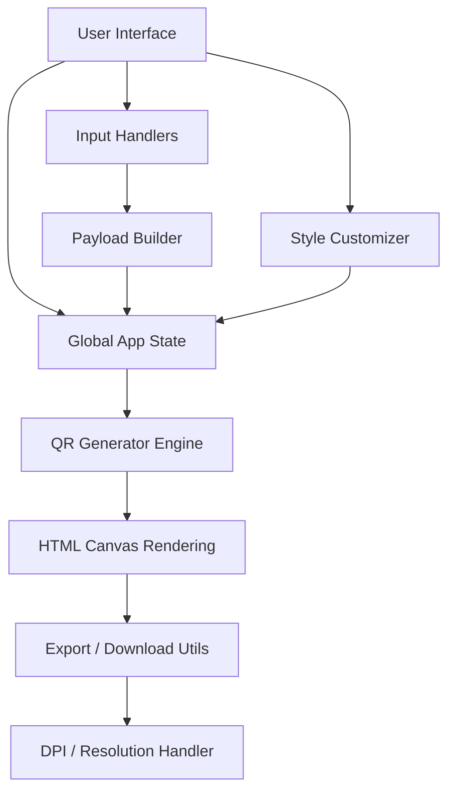

# Client-Side Architecture

The QR Code Gen is built as a **100% client-side application**. It requires no server-side processing for QR generation, image manipulation, or exporting.

This document explains the high-level architecture, module structure, and data flow of the application.

---

## 🏗️ High-Level Design

The application follows a modular, component-based structure using Vanilla JavaScript and Vite as the build tool.



---

## 📁 Module Breakdown

The logic is split into four main domains under `src/`:

### 1. `components/` (UI & User Interaction)
- **`input-forms.js`**: `FORMS` field definitions per QR type and the dynamic form renderer. It does not attach listeners — `main.js` delegates once on the container.
- **`customizer.js`**: Design controls. A single `DESIGN_FIELDS` list drives reading (`getDesignOptions`), persistence/share (`serializeDesign` / `applyDesign`) and reset. Style grids use radio semantics with arrow-key navigation.
- **`error-handler.js`**: Toast alerts in an `aria-live` region. Messages are inserted as text, never HTML; an `id` replaces an existing alert.

### 2. `qr-engine/` (Core Data & Rendering)
- **`payload-builder.js`** *(pure)*: Form values → standard payloads (`mailto:`, `WIFI:`, vCard 3.0, iCalendar, BIP21 …) with correct escaping per format.
- **`qr-options.js`** *(pure)*: Design state → `qr-code-styling` options. Shared by preview and every export so they can't drift apart.
- **`scannability.js`** *(pure)*: Heuristic warnings (contrast < 3:1, inverted colours, large logo with low error correction).
- **`generator.js`**: Renders the preview (off-DOM first, so a failed render keeps the previous code), exports PNG/SVG/JPG/WebP/PDF, copies to clipboard. jsPDF is dynamically imported.
- **`logo-handler.js`**: Reads uploads (type/size checked) and composites the logo tile on a canvas. The result is memoised, so slider/colour drags don't redo the expensive canvas work.

### 3. `utils/` (Helpers)
- **`color-utils.js`**: WCAG luminance and contrast ratio.
- **`download.js`**: Blob download (delayed URL revocation), descriptive filenames, image/canvas helpers.
- **`dpi.js`**: Injects DPI metadata (PNG `pHYs`, JPEG JFIF).
- **`share.js`**: UTF-8 + base64url encode/decode for share links (reads legacy `?config=` links too).

### 4. `main.js` (Application Entry Point)
Owns app state and wires modules together: debounced render pipeline (with a sequence guard against out-of-order async renders), type switching, logo input, theme, export buttons, share links and service-worker registration.

### Tests
`tests/` contains Vitest unit tests for the pure modules (`npm test`).

---

## 🎨 Styling Architecture (SCSS)

All styles are written using SCSS and compiled by Vite. The UI does not rely on any heavy CSS frameworks, instead using a custom styling architecture rooted in design tokens.

### SCSS Partials

| File               | Responsibility                              |
|--------------------|----------------------------------------------|
| `_variables.scss`  | Design tokens — colors, spacing, typography |
| `_reset.scss`      | Base reset and box-model normalization       |
| `_layout.scss`     | Two-panel (sidebar + preview) layout         |
| `_sidebar.scss`    | Left control panel styles                   |
| `_forms.scss`      | Input fields, selects, labels               |
| `_buttons.scss`    | Button component styles & states            |
| `_preview.scss`    | QR preview panel and download section       |
| `_footer.scss`     | Footer layout and link styles               |
| `main.scss`        | Entry point — imports all partials          |

### Theme & Design Tokens (`_variables.scss`)
Themes are CSS custom properties: dark values on `:root`, light overrides on `:root[data-theme="light"]`. An inline script in `<head>` sets `data-theme` before first paint (saved choice, else `prefers-color-scheme`), so there is no flash of the wrong theme.

```scss
// Example Token Structure
:root {
  --bg-primary: #ffffff;
  --text-primary: #1a1a1a;
  --accent-color: #0066cc;
}

[data-theme="dark"] {
  --bg-primary: #121212;
  --text-primary: #f5f5f5;
  --accent-color: #66b3ff;
}
```

Components reference these variables, ensuring immediate and consistent visual updates when the theme is toggled.

> **Rule:** All styles must be written and compiled from `.scss` files only. Never write or edit `.css` files directly.

---

## 🌐 PWA & SEO Layer (`public/`)

Static assets in `public/` enable offline support and search engine discoverability:

| File            | Purpose                                          |
|-----------------|---------------------------------------------------|
| `manifest.json` | PWA web app manifest (name, icons, theme color)  |
| `sw.js`         | Service worker — caches assets for offline use   |
| `favicon.svg`   | Vector favicon                                   |
| `og-image.png`  | Open Graph image for social media previews       |
| `robots.txt`    | Search crawler directives                        |
| `sitemap.xml`   | XML sitemap for SEO indexing                     |
| `icons/`        | PWA icons (192×192 and 512×512)                  |

---

## 🔒 Security & Privacy Model

By design, the application has complete data localization:

1. **No Backend**: The app consists purely of static files (`index.html`, `.js`, compiled `.css`, standard assets).
2. **Local Processing**: `FileReader`, `Canvas.toDataURL()`, and `Blob` APIs are used for all image parsing and file generation.
3. **Storage**: Form content, design settings and theme are written only to the browser's `localStorage`.
4. **Third-Party Requests**: The app avoids fetching external fonts or assets at runtime to prevent third-party tracking.
5. **Offline-Capable**: The service worker (`sw.js`) serves pages network-first (so new releases arrive immediately) and hashed assets cache-first. Each build stamps a new cache name, purging stale caches.
6. **Share links** use the URL *fragment* (`#config=…`), which browsers never send to the server.
